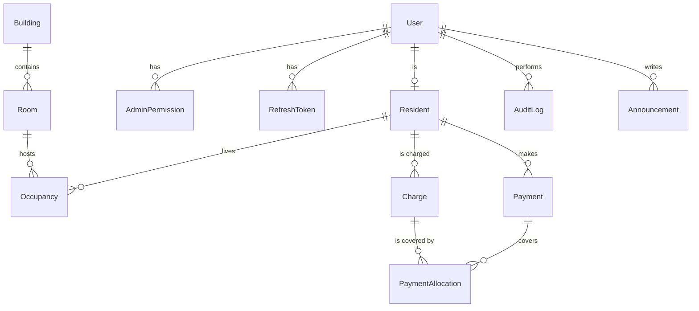

# 🏢 BehaAtel — Система управления общежитием

> Полноценный веб-сайт (Frontend + Backend) для общежития **BehaAtel**: личный кабинет жильца и административная панель с контролем платежей, жильцов, комнат и администраторов.

---

## 📌 Содержание

1. [О проекте](#1-о-проекте)
2. [Цели](#2-цели)
3. [Роли и права](#3-роли-и-права)
4. [Функциональные требования](#4-функциональные-требования)
5. [Технологический стек](#5-технологический-стек) 
6. [Архитектура бэкенда (Clean Architecture)](#6-архитектура-бэкенда-clean-architecture)
7. [Доменная модель](#7-доменная-модель)
8. [REST API](#8-rest-api)
9. [Фронтенд](#9-фронтенд)
10. [Безопасность](#10-безопасность)
11. [Нефункциональные требования](#11-нефункциональные-требования)
12. [Этапы разработки](#12-этапы-разработки)
13. [Запуск проекта](#13-запуск-проекта)
14. [Критерии приёмки](#14-критерии-приёмки)

---

## 1. О проекте

**BehaAtel** — веб-платформа для управления общежитием. Система автоматизирует:

- учёт жильцов, зданий, комнат и мест;
- начисление ежемесячной оплаты за проживание;
- приём и учёт платежей (транзакций);
- контроль долгов;
- управление администраторами с гибким ограничением прав.

В системе **две панели**:

| Панель | Для кого | Что делает |
|---|---|---|
| **User Panel** (личный кабинет) | Жилец | Смотрит свой долг, начисления, историю платежей, графики |
| **Admin Panel** | Администраторы | Полный контроль: жильцы, комнаты, платежи, отчёты, админы |

---

## 2. Цели

- Заменить ручной учёт (тетради / Excel) единой системой.
- Дать жильцу прозрачную информацию: **сколько он должен заплатить за месяц и общий баланс**.
- Дать администрации полный контроль над финансами и данными.
- Сделать красивый, современный и удобный интерфейс (адаптивный, тёмная/светлая тема).
- Построить расширяемый бэкенд на **Clean Architecture**.

---

## 3. Роли и права

### 3.1. Роли

| Роль | Описание |
|---|---|
| `SuperAdmin` | Главный администратор. **Создаётся автоматически при первом запуске бэкенда (seed)**. Не может быть удалён или заблокирован. |
| `Admin` | Администратор, созданный SuperAdmin-ом. Права ограничиваются набором permissions. |
| `User` | Жилец общежития. Видит только свои данные. |

### 3.2. SuperAdmin по умолчанию

Создаётся при старте приложения, если в БД его ещё нет. Данные берутся из конфигурации (`appsettings` / переменные окружения), **не хардкодятся в коде**:

```json
"SeedAdmin": {
  "Email": "superadmin@behaatel.com",
  "Password": "ChangeMe123!",
  "FullName": "Super Admin"
}
```

> ⚠️ При первом входе SuperAdmin обязан сменить пароль (`MustChangePassword = true`).

### 3.3. Ограничение администраторов (Permissions)

SuperAdmin при создании/редактировании админа выбирает, что тому разрешено:

| Permission | Что даёт |
|---|---|
| `Residents.View` / `Residents.Manage` | Просмотр / создание, редактирование, удаление жильцов |
| `Rooms.View` / `Rooms.Manage` | Просмотр / управление зданиями и комнатами |
| `Charges.View` / `Charges.Manage` | Просмотр / создание начислений и тарифов |
| `Payments.View` / `Payments.Manage` | Просмотр / регистрация и отмена платежей |
| `Reports.View` | Дашборд, графики, отчёты |
| `Announcements.Manage` | Объявления |
| `Admins.Manage` | Только у SuperAdmin (не выдаётся другим) |

Дополнительно SuperAdmin может:

- **заблокировать / разблокировать** администратора (`IsActive`);
- удалить администратора (soft delete);
- сбросить пароль администратора;
- видеть **журнал действий (Audit Log)** каждого админа.

---

## 4. Функциональные требования

### 4.1. Аутентификация и авторизация

- Вход по email + пароль.
- JWT Access Token (15 мин) + Refresh Token (7 дней, ротация).
- Выход, смена пароля, восстановление пароля (на втором этапе — через email).
- Авторизация по ролям и permissions (policy-based).
- Заблокированный пользователь/админ не может войти и его токены отзываются.

### 4.2. 👤 Панель жильца (User Panel)

| # | Функция |
|---|---|
| U1 | **Главная (Dashboard):** карточки — «К оплате за этот месяц», «Общий баланс / долг», «Следующий срок оплаты», «Последний платёж» |
| U2 | **Диаграмма:** начислено vs оплачено по месяцам (за 12 мес.) |
| U3 | **Диаграмма:** структура начислений (проживание, коммуналка, штрафы и т.д.) |
| U4 | **Начисления:** список по месяцам со статусом (`Оплачено` / `Частично` / `Долг`) |
| U5 | **История платежей:** дата, сумма, способ оплаты, статус, номер квитанции |
| U6 | **Профиль:** ФИО, телефон, email, комната, дата заселения, смена пароля |
| U7 | **Моя комната:** здание, этаж, номер комнаты, соседи (только имена) |
| U8 | **Объявления** от администрации |
| U9 | Скачивание квитанции (PDF) — *опционально* |

> Жилец **не может** видеть данные других жильцов и ничего не может изменять в финансах.

### 4.3. 🛠 Панель администратора (Admin Panel)

| # | Функция |
|---|---|
| A1 | **Dashboard:** KPI-карточки — всего жильцов, занятость комнат (%), доход за месяц, общий долг, число должников |
| A2 | **Диаграммы:** доход по месяцам (bar), платежи по способам оплаты (donut), заселённость по зданиям, топ-должники |
| A3 | **Транзакции:** полная таблица всех платежей с фильтрами (период, жилец, статус, способ), поиском, сортировкой, пагинацией, экспортом в Excel/CSV |
| A4 | **Жильцы:** CRUD, поиск, фильтр по долгу/зданию, карточка жильца (финансовая история), заселение / выселение |
| A5 | **Здания и комнаты:** CRUD, вместимость, занятость, тип комнаты, цена места |
| A6 | **Тарифы и начисления:** настройка цены, ручное и автоматическое начисление (раз в месяц), штрафы, скидки |
| A7 | **Платежи:** регистрация платежа (наличные / карта / перевод), отмена (с причиной), автоматическое закрытие долга |
| A8 | **Долги:** список должников, суммы, срок просрочки |
| A9 | **Администраторы** *(только SuperAdmin)*: создать админа, задать permissions, заблокировать, удалить, сбросить пароль |
| A10 | **Audit Log:** кто, когда и что сделал (создание, изменение, удаление, вход) |
| A11 | **Объявления:** создание и публикация для жильцов |
| A12 | **Настройки:** валюта, день начисления, срок оплаты, размер штрафа за просрочку |

### 4.4. Бизнес-логика финансов

- Деньги хранятся как `decimal(18,2)`, валюта настраиваемая (по умолчанию **TJS**).
- **Баланс жильца** = `Сумма платежей − Сумма начислений`. Отрицательный — долг, положительный — переплата.
- Начисления создаются автоматически **фоновой задачей** (`BackgroundService` / Hangfire) 1-го числа каждого месяца для всех заселённых жильцов.
- Платёж закрывает самые старые долги первыми (FIFO).
- Платежи не удаляются физически — только **отменяются** (`Cancelled`) с записью причины и автора.

---

## 5. Технологический стек

### Backend
| Назначение | Технология |
|---|---|
| Платформа | **.NET 8** (или новее), **ASP.NET Core Web API** |
| Архитектура | **Clean Architecture** + CQRS |
| ORM | Entity Framework Core + Fluent API |
| БД | **PostgreSQL** (допустимо SQL Server) |
| CQRS / Pipeline | MediatR (+ Behaviors: Validation, Logging) |
| Валидация | FluentValidation |
| Маппинг | Mapster / AutoMapper |
| Аутентификация | ASP.NET Core Identity (или кастомная) + JWT Bearer |
| Фоновые задачи | Hangfire / `BackgroundService` |
| Логирование | Serilog |
| Документация API | Swagger / OpenAPI |
| Тесты | xUnit, FluentAssertions, Moq, Testcontainers |
| Контейнеры | Docker, docker-compose |

### Frontend
**Выбор: React + TypeScript + Vite** — проект это SPA-панель за авторизацией, SEO не нужен, поэтому Next.js избыточен.

| Назначение | Технология |
|---|---|
| Фреймворк | React 18 + TypeScript + Vite |
| Стили | Tailwind CSS + **shadcn/ui** |
| Роутинг | React Router |
| Запросы к API | TanStack Query + Axios |
| Формы | React Hook Form + Zod |
| Графики | Recharts |
| Таблицы | TanStack Table |
| Анимации | Framer Motion |
| Иконки | lucide-react |
| Уведомления | sonner |

---

## 6. Архитектура бэкенда (Clean Architecture)

Правило зависимостей: **внешние слои зависят от внутренних, а не наоборот**.

```
Presentation (API)  →  Infrastructure  →  Application  →  Domain
```

### 6.1. Структура решения

```
BehaAtel/
├── backend/
│   ├── BehaAtel.sln
│   ├── src/
│   │   ├── BehaAtel.Domain/              # Сущности, Enums, ValueObjects, доменные исключения
│   │   │   ├── Entities/
│   │   │   ├── Enums/
│   │   │   ├── Common/                   # BaseEntity, IAuditable, ISoftDelete
│   │   │   └── Exceptions/
│   │   │
│   │   ├── BehaAtel.Application/         # Бизнес-логика, не знает про БД и HTTP
│   │   │   ├── Common/
│   │   │   │   ├── Interfaces/           # IApplicationDbContext, ICurrentUser, IJwtService, IDateTime ...
│   │   │   │   ├── Behaviors/            # ValidationBehavior, LoggingBehavior
│   │   │   │   ├── Models/               # Result<T>, PagedList<T>
│   │   │   │   └── Exceptions/
│   │   │   ├── Features/
│   │   │   │   ├── Auth/                 # Commands / Queries / Validators / DTOs
│   │   │   │   ├── Admins/
│   │   │   │   ├── Residents/
│   │   │   │   ├── Rooms/
│   │   │   │   ├── Charges/
│   │   │   │   ├── Payments/
│   │   │   │   ├── Dashboard/
│   │   │   │   ├── Announcements/
│   │   │   │   └── AuditLogs/
│   │   │   └── DependencyInjection.cs
│   │   │
│   │   ├── BehaAtel.Infrastructure/      # Реализации: БД, JWT, email, фоновые задачи
│   │   │   ├── Persistence/
│   │   │   │   ├── ApplicationDbContext.cs
│   │   │   │   ├── Configurations/       # Fluent API
│   │   │   │   ├── Migrations/
│   │   │   │   └── Seed/                 # DbInitializer (SuperAdmin + базовые данные)
│   │   │   ├── Identity/
│   │   │   ├── Services/
│   │   │   ├── BackgroundJobs/           # MonthlyChargeJob
│   │   │   └── DependencyInjection.cs
│   │   │
│   │   └── BehaAtel.WebApi/              # Controllers, Middleware, Program.cs
│   │       ├── Controllers/
│   │       ├── Middleware/               # ExceptionHandling, RequestLogging
│   │       ├── Filters/
│   │       ├── Authorization/            # Permission policies
│   │       ├── Program.cs
│   │       └── appsettings.json
│   │
│   └── tests/
│       ├── BehaAtel.Domain.UnitTests/
│       ├── BehaAtel.Application.UnitTests/
│       └── BehaAtel.WebApi.IntegrationTests/
│
├── frontend/                             # См. раздел 9
├── docker-compose.yml
└── README.md
```

### 6.2. Принципы

- **Domain** — без зависимостей от фреймворков.
- **Application** — use-case’ы как `Command` / `Query` через MediatR; контроллеры «тонкие».
- **Infrastructure** — реализует интерфейсы из Application.
- **WebApi** — только HTTP: маршруты, авторизация, обработка ошибок (`ProblemDetails`).
- Единый формат ошибок, глобальный `ExceptionHandlingMiddleware`.
- Soft delete + аудит (`CreatedAt`, `CreatedBy`, `UpdatedAt`, `UpdatedBy`) через `SaveChanges` interceptor.

---

## 7. Доменная модель

### 7.1. Сущности

| Сущность | Основные поля |
|---|---|
| **User** | `Id`, `Email`, `PasswordHash`, `FullName`, `Phone`, `Role`, `IsActive`, `MustChangePassword`, `LastLoginAt` |
| **AdminPermission** | `UserId`, `Permission` |
| **RefreshToken** | `Id`, `UserId`, `Token`, `ExpiresAt`, `RevokedAt` |
| **Resident** | `Id`, `UserId`, `PassportNumber`, `BirthDate`, `University/Work`, `CheckInDate`, `CheckOutDate`, `Status` |
| **Building** | `Id`, `Name`, `Address`, `FloorsCount` |
| **Room** | `Id`, `BuildingId`, `Number`, `Floor`, `Capacity`, `PricePerBed`, `Type` |
| **Occupancy** | `Id`, `ResidentId`, `RoomId`, `From`, `To` |
| **Charge** | `Id`, `ResidentId`, `Period (yyyy-MM)`, `Type`, `Amount`, `DueDate`, `Description`, `Status` |
| **Payment** | `Id`, `ResidentId`, `Amount`, `Method`, `Status`, `PaidAt`, `ReceiptNumber`, `Comment`, `CancelledReason` |
| **PaymentAllocation** | `PaymentId`, `ChargeId`, `Amount` |
| **Announcement** | `Id`, `Title`, `Body`, `PublishedAt`, `AuthorId` |
| **AuditLog** | `Id`, `UserId`, `Action`, `EntityName`, `EntityId`, `OldValues`, `NewValues`, `CreatedAt`, `Ip` |
| **Setting** | `Key`, `Value` |

### 7.2. Enums

```
Role:           SuperAdmin, Admin, User
ResidentStatus: Active, CheckedOut
ChargeType:     Rent, Utilities, Penalty, Other
ChargeStatus:   Unpaid, PartiallyPaid, Paid, Cancelled
PaymentMethod:  Cash, Card, BankTransfer, Online
PaymentStatus:  Completed, Cancelled
```

### 7.3. ER-диаграмма



---

## 8. REST API

Базовый префикс: `/api/v1`. Все ответы — JSON, ошибки — `ProblemDetails`.

### Auth
| Метод | Путь | Описание |
|---|---|---|
| POST | `/auth/login` | Вход |
| POST | `/auth/refresh` | Обновление токена |
| POST | `/auth/logout` | Выход (отзыв refresh) |
| POST | `/auth/change-password` | Смена пароля |

### User Panel (`Role = User`)
| Метод | Путь | Описание |
|---|---|---|
| GET | `/me` | Профиль и комната |
| GET | `/me/summary` | К оплате за месяц, баланс, ближайший срок |
| GET | `/me/charges` | Начисления (фильтр по периоду) |
| GET | `/me/payments` | История платежей |
| GET | `/me/charts/monthly` | Данные для диаграммы начислено/оплачено |
| GET | `/me/announcements` | Объявления |

### Admin Panel (`Role = Admin | SuperAdmin` + permissions)
| Метод | Путь | Permission |
|---|---|---|
| GET | `/admin/dashboard` | `Reports.View` |
| GET | `/admin/dashboard/charts` | `Reports.View` |
| GET/POST/PUT/DELETE | `/admin/residents` | `Residents.*` |
| POST | `/admin/residents/{id}/check-in` | `Residents.Manage` |
| POST | `/admin/residents/{id}/check-out` | `Residents.Manage` |
| GET/POST/PUT/DELETE | `/admin/buildings`, `/admin/rooms` | `Rooms.*` |
| GET/POST | `/admin/charges` | `Charges.*` |
| POST | `/admin/charges/generate?period=2026-10` | `Charges.Manage` |
| GET | `/admin/payments` | `Payments.View` |
| POST | `/admin/payments` | `Payments.Manage` |
| POST | `/admin/payments/{id}/cancel` | `Payments.Manage` |
| GET | `/admin/debtors` | `Payments.View` |
| GET | `/admin/transactions/export` | `Payments.View` |
| GET/POST | `/admin/announcements` | `Announcements.Manage` |
| GET | `/admin/audit-logs` | `SuperAdmin` |

### SuperAdmin only
| Метод | Путь | Описание |
|---|---|---|
| GET | `/superadmin/admins` | Список админов |
| POST | `/superadmin/admins` | Создать админа + permissions |
| PUT | `/superadmin/admins/{id}/permissions` | Изменить права |
| POST | `/superadmin/admins/{id}/block` | Заблокировать |
| POST | `/superadmin/admins/{id}/unblock` | Разблокировать |
| POST | `/superadmin/admins/{id}/reset-password` | Сбросить пароль |
| DELETE | `/superadmin/admins/{id}` | Удалить (soft) |

Для списков — единый формат пагинации: `?page=1&pageSize=20&search=&sortBy=&sortDir=`.

---

## 9. Фронтенд

### 9.1. Структура

```
frontend/
├── src/
│   ├── app/                  # Провайдеры, роутер, layout'ы
│   ├── api/                  # Axios-клиент, интерсепторы, хуки TanStack Query
│   ├── components/
│   │   ├── ui/               # shadcn/ui
│   │   ├── charts/           # Обёртки над Recharts
│   │   └── shared/           # DataTable, StatCard, EmptyState, ConfirmDialog
│   ├── features/
│   │   ├── auth/
│   │   ├── user/             # Страницы личного кабинета
│   │   └── admin/            # Страницы админ-панели
│   ├── hooks/
│   ├── lib/                  # utils, форматтеры денег/дат
│   ├── store/                # Auth store (Zustand)
│   ├── types/
│   └── main.tsx
├── index.html
├── tailwind.config.ts
└── vite.config.ts
```

### 9.2. Страницы

**Публичные:** `/login`, (опционально лендинг `/` с описанием общежития).

**Жилец:** `/app` (Dashboard), `/app/charges`, `/app/payments`, `/app/room`, `/app/announcements`, `/app/profile`.

**Админ:** `/admin` (Dashboard), `/admin/residents`, `/admin/residents/:id`, `/admin/rooms`, `/admin/charges`, `/admin/payments`, `/admin/debtors`, `/admin/announcements`, `/admin/admins` *(SuperAdmin)*, `/admin/audit` *(SuperAdmin)*, `/admin/settings`.

### 9.3. Требования к дизайну и UX

- Современный чистый стиль: скруглённые карточки, мягкие тени, аккуратная типографика (Inter / Manrope).
- **Светлая и тёмная темы**.
- Адаптивность: desktop → tablet → mobile (боковое меню превращается в бургер).
- Брендовый акцентный цвет (предложение: индиго/изумруд) — задаётся через CSS-переменные.
- Skeleton-загрузка, empty states, toast-уведомления, подтверждение опасных действий.
- Графики с тултипами и анимацией; суммы форматируются с валютой.
- Пункты меню и кнопки, на которые у админа нет permission, **скрываются** (но бэкенд всё равно проверяет права).
- Доступность: фокус-состояния, контраст, навигация с клавиатуры.

---

## 10. Безопасность

- Пароли — только хэши (PBKDF2 / Argon2 / bcrypt), никогда в открытом виде.
- Секреты (JWT key, строка БД, пароль SuperAdmin) — только через env / user-secrets.
- Все эндпоинты закрыты `[Authorize]`, кроме `/auth/login` и `/auth/refresh`.
- Проверка прав **на бэкенде**: жилец видит только свои данные (фильтр по `CurrentUser.Id`).
- Rate limiting на логин, защита от brute-force (временная блокировка после N попыток).
- CORS — только доверенные origin’ы.
- Валидация всех входных данных (FluentValidation + Zod на фронте).
- Защита от XSS/CSRF, HTTPS, security-заголовки.
- Аудит всех критичных действий.

---

## 11. Нефункциональные требования

| Категория | Требование |
|---|---|
| Производительность | Ответ API ≤ 500 мс для типовых запросов; серверная пагинация везде |
| Надёжность | Транзакции БД при платежах и начислениях; идемпотентность генерации начислений |
| Масштабируемость | Stateless API, готов к горизонтальному масштабированию |
| Качество кода | Покрытие unit-тестами Application-слоя ≥ 70% |
| Логи | Структурные логи (Serilog) в консоль и файл |
| Локализация | Минимум RU; архитектура готова к TJ / EN |
| Документация | Swagger со всеми эндпоинтами и примерами |

---

## 12. Этапы разработки

| Этап | Содержание | Результат |
|---|---|---|
| **1. Фундамент** | Solution по Clean Architecture, БД, миграции, Serilog, Swagger, обработка ошибок | Каркас API |
| **2. Auth** | Identity/JWT, refresh, seed SuperAdmin, permissions | Вход работает |
| **3. Админы** | CRUD админов, блокировка, права, аудит | SuperAdmin управляет админами |
| **4. Здания/комнаты/жильцы** | CRUD, заселение/выселение | Учёт жильцов |
| **5. Финансы** | Тарифы, начисления, фоновая задача, платежи, баланс, долги | Ядро системы |
| **6. Dashboard и отчёты** | Агрегации для графиков, экспорт | Аналитика |
| **7. Фронтенд — основа** | Vite + Tailwind + shadcn, auth, layout’ы, роутинг | Каркас UI |
| **8. Фронтенд — User Panel** | Личный кабинет с графиками | Панель жильца |
| **9. Фронтенд — Admin Panel** | Все разделы админки | Панель админа |
| **10. Полировка** | Тесты, Docker, адаптив, тёмная тема, README | Релиз |

---

## 13. Запуск проекта

### Требования
- .NET SDK 8+
- Node.js 20+
- PostgreSQL 15+ (или Docker)

### Через Docker
```bash
docker compose up -d --build
```
- Frontend: http://localhost:3000
- API / Swagger: http://localhost:5000/swagger

### Вручную

**Backend**
```bash
cd backend/src/BehaAtel.WebApi
dotnet user-secrets set "ConnectionStrings:Default" "Host=localhost;Database=behaatel;Username=postgres;Password=postgres"
dotnet user-secrets set "Jwt:Key" "<длинный-секретный-ключ-32+символа>"
dotnet ef database update --project ../BehaAtel.Infrastructure
dotnet run
```
При первом запуске автоматически создаются миграции-данные и **SuperAdmin** из секции `SeedAdmin`.

**Frontend**
```bash
cd frontend
npm install
cp .env.example .env     # VITE_API_URL=http://localhost:5000/api/v1
npm run dev
```

---

## 14. Критерии приёмки

- [ ] При первом запуске бэкенд создаёт SuperAdmin; вход под ним работает.
- [ ] SuperAdmin может создать админа, назначить права, заблокировать и удалить его.
- [ ] Админ без нужного permission не видит раздел и получает `403` от API.
- [ ] Заблокированный админ не может войти.
- [ ] Админ может создать жильца, заселить его в комнату и зарегистрировать платёж.
- [ ] Начисления за месяц создаются автоматически и не дублируются.
- [ ] Жилец видит «К оплате за месяц», общий баланс, историю и диаграммы только по себе.
- [ ] Админ-дашборд показывает KPI и диаграммы; таблица транзакций с фильтрами и экспортом.
- [ ] Все критичные действия попадают в Audit Log.
- [ ] Интерфейс адаптивен, есть светлая и тёмная темы.
- [ ] Swagger описывает все эндпоинты; unit-тесты проходят.

---

## 📄 Лицензия

Проект разрабатывается для общежития **BehaAtel**. Лицензия определяется владельцем проекта.